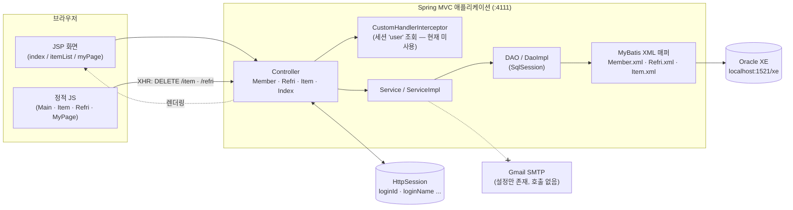
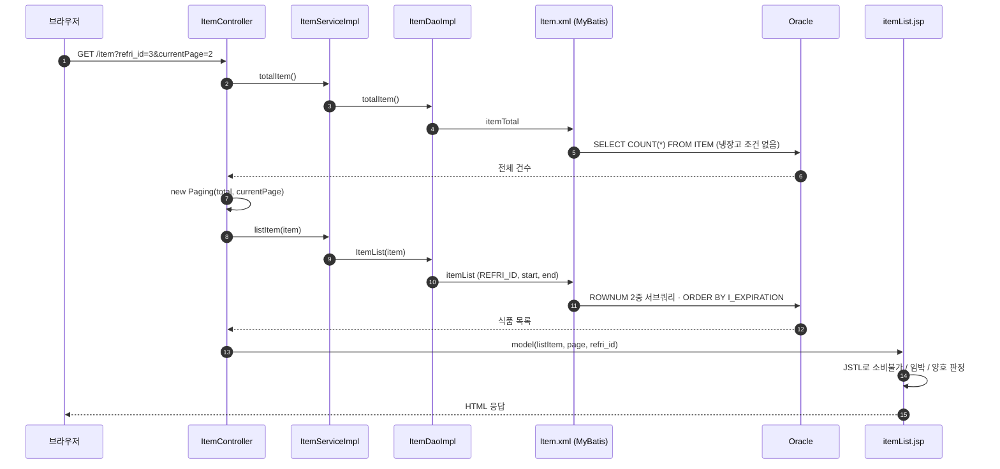

# NangJangGo — 냉장고 재고·유통기한 관리 (포트폴리오 정리)

---

## 1. 한 줄 요약

회원이 자신의 냉장고를 등록하고, 그 안의 식품을 등록하면 **유통기한 상태(양호 / 임박 / 소비불가)를 자동으로 표시**해 주는 서버 렌더링(JSP) 웹 애플리케이션입니다.

---

## 2. 기술 스택

| 분류 | 내용 | 버전 (확인 근거) |
|---|---|---|
| 언어 | Java | **11** (`build.gradle`의 `sourceCompatibility`) |
| 백엔드 프레임워크 | Spring Boot, Spring MVC | **2.7.13** |
| 데이터 접근 | MyBatis (`mybatis-spring-boot-starter`), XML 매퍼 | **2.3.0** |
| DB | Oracle (XE, `localhost:1521/xe`) | JDBC `ojdbc8` (Boot 관리 버전) |
| 뷰 | JSP + JSTL, `tomcat-embed-jasper` | JSTL 및 Jasper 버전은 Boot 관리 |
| 프론트엔드 | 바닐라 JavaScript (XMLHttpRequest), 정적 CSS | 프레임워크 없음 |
| 기타 라이브러리 | json-simple **1.1.1**, Lombok, Spring Boot DevTools, Bean Validation | 선언만 있고 사용처 미확인 (json-simple) |
| 빌드 | Gradle Wrapper | **8.1.1** (`gradle-wrapper.properties`) |
| 인프라 | 별도 설정 없음 (로컬 실행 전제) | Docker·배포 설정 없음 |
| 메일 | Gmail SMTP 설정 (`spring.mail`) | **설정만 있고 메일 발송 코드는 없음** |

---

## 3. 구조

**구조 설명**
- **단일 Spring MVC 모놀리식 애플리케이션**입니다. 서버가 JSP로 HTML을 그려 주고, 일부 동작만 XMLHttpRequest로 호출합니다. 포트는 `4111`입니다.
- 계층은 `Controller → Service(인터페이스 + Impl) → DAO(인터페이스 + Impl, SqlSession 사용) → MyBatis XML 매퍼 → Oracle`입니다.
- 인증은 **HttpSession 기반 로그인**이며, 로그인 정보를 세션 속성(`loginId`, `loginName` 등)에 개별로 저장합니다.
- 도메인은 `member`(회원), `refri`(냉장고), `item`(식품), `main`(메인 페이지)으로 나뉘어 있습니다.

**주요 디렉터리/패키지 (핵심 7개)**

| 경로 | 역할 |
|---|---|
| `domain/member/` | 회원가입, 로그인·로그아웃, 마이페이지, 회원정보 수정·탈퇴 |
| `domain/refri/` | 냉장고 등록·목록 조회·삭제 (삭제 시 하위 식품 먼저 삭제) |
| `domain/item/` | 식품 등록·목록(페이징)·삭제·검색, `Paging` 클래스 |
| `domain/main/` | 메인 페이지 라우팅(`/`, `/index`) |
| `config/` | `WebConfig`(인터셉터·인자 리졸버 등록), `LoginUser` 어노테이션, `LoginUserArgumentResolver`, `SessionUser`, `login/CustomHandlerInterceptor` |
| `resources/mappers/` | MyBatis SQL (`Member.xml`, `Refri.xml`, `Item.xml`) |
| `webapp/WEB-INF/views/` | JSP 화면 (`fragments/` 공통 헤더·푸터·모달, `item/itemList.jsp`, `member/myPage.jsp` 등) |

**외부 시스템 연동 지점**
- **Oracle DB** (MyBatis, `SEQUENCE` 사용: `MEMBER_ID_SEQ`, `REFRI_ID_SEQ`, `ITEM_ID_SEQ`)
- **SMTP(Gmail)**: 설정 파일에만 있고 실제 호출 코드는 없습니다.
- 캐시, 메시지 큐, 외부 API: 발견되지 않음

---

## 4. 데이터 흐름

### 4-1. 로그인
1. 메인 페이지의 로그인 모달 → `POST /login` (아이디, 비밀번호)
2. `MemberController.memberLogin()` → `MemberServiceImpl.memberLogin()`
3. `passMember` 쿼리로 저장된 비밀번호를 가져와 **입력값과 문자열 `equals` 비교**
4. 일치하면 `infoMember`로 회원 정보를 조회하고, 세션에 `loginName`, `loginId`, `loginM_ID`, `loginM_PASS`, `loginM_EMAIL`을 저장
5. `model`에 `loginYn`(1 또는 0)을 담아 `index.jsp`로 이동. 헤더가 이 값으로 로그인 UI를 바꾸고, 성공 시 `alert`를 띄움

### 4-2. 식품 목록 조회 (페이징 + 유통기한 표시)
1. `GET /item?refri_id=…&currentPage=…` → `ItemController.item()`
2. `ItemService.totalItem()` → `itemTotal` 쿼리로 전체 건수 조회 → `Paging` 객체 생성 (시작·끝 행, 페이지 블록 계산)
3. `ItemList` → `itemList` 매퍼: `REFRI_ID` 조건 + `ORDER BY I_EXPIRATION` + `ROWNUM` 2중 서브쿼리로 구간 추출
4. `itemList.jsp`에서 JSTL로 상태 판정: 현재 시각이 유통기한 이후면 **소비불가**(빨강), 유통기한 7일 전 이후면 **유통기한 임박**(주황), 그 외 **양호**(초록)

### 4-3. 냉장고 등록과 삭제
- **등록**: `POST /refri` → 세션의 `loginId` 확인 → `REFRI_ID_SEQ.nextval`로 ID 채번 → `REFRIGERATOR` INSERT → `/mypage`로 리다이렉트
- **삭제**: `Refri.js`가 `DELETE /refri/{id}`를 XHR로 호출 → `RefriServiceImpl.deleteRefri()`가 `deleteCascade`(해당 냉장고의 `ITEM` 삭제) 후 `deleteRefri`(냉장고 삭제) 순으로 실행

### 4-4. 배치 · 스케줄러 · 비동기
- `@Scheduled`, `@Async`, `@Transactional`이 **코드에 없습니다.** 모든 처리는 요청 단위 동기 처리이며, 삭제 2단계도 하나의 트랜잭션으로 묶여 있지 않습니다.

---

## 5. 다이어그램

### 5-1. 구조 (flowchart)

### 5-2. 식품 목록 조회 (sequenceDiagram)

---

## 6. 포트폴리오 소재 후보

### 6-1. 눈에 띄는 설계·기술 포인트 (3개)

1. **유통기한 상태를 서버 데이터로 판정하는 도메인 기능**
   - 유통기한을 `java.util.Date`로 저장하고, JSTL에서 "현재 시각 > 유통기한"이면 소비불가, "현재 시각 > 유통기한 − 7일"이면 임박으로 판정합니다.
   - *의미*: 사용자가 만료 날짜를 직접 계산하지 않아도 되도록 요구사항을 화면 규칙으로 옮긴 사례입니다. 판정 기준을 한 곳(JSP)에 모은 점도 설명할 수 있습니다.

2. **MyBatis + Oracle ROWNUM으로 구현한 페이징과 블록 페이지네이션**
   - `Paging` 클래스가 현재 페이지로 시작·끝 행을 계산하고, 페이지 블록(`pageBlock=10`)과 마지막 페이지 보정(`endPage > totalPage`)을 처리합니다.
   - SQL은 `ROWNUM` 2중 서브쿼리로 구간을 잘라 냅니다.
   - *의미*: 페이징 계산을 DB 쿼리와 Java 객체로 나눠 설계했고, Oracle 고유의 페이징 방식을 직접 다뤘다는 점을 보여 줄 수 있습니다. 단, 아래 약점 2번의 total 계산 문제와 함께 설명해야 합니다.

3. **냉장고 → 식품의 1:N 소유 구조와 삭제 순서 제어**
   - `REFRIGERATOR`와 `ITEM`을 `REFRI_ID`로 연결하고, 냉장고 삭제 시 `deleteCascade`로 식품을 먼저 지운 뒤 냉장고를 지웁니다. ID는 DB 시퀀스(`nextval`)로 채번합니다.
   - *의미*: 외래 키 제약 없이 애플리케이션 계층에서 연쇄 삭제를 관리한 사례입니다. 트랜잭션 처리와 함께 보면 개선 과정을 설명하기 좋습니다.
